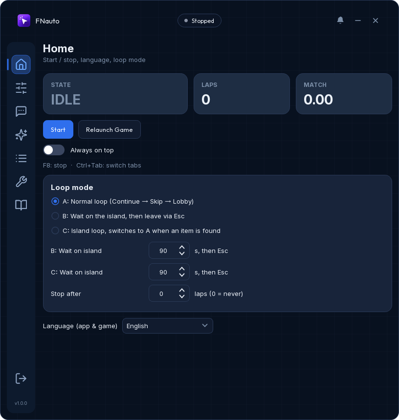
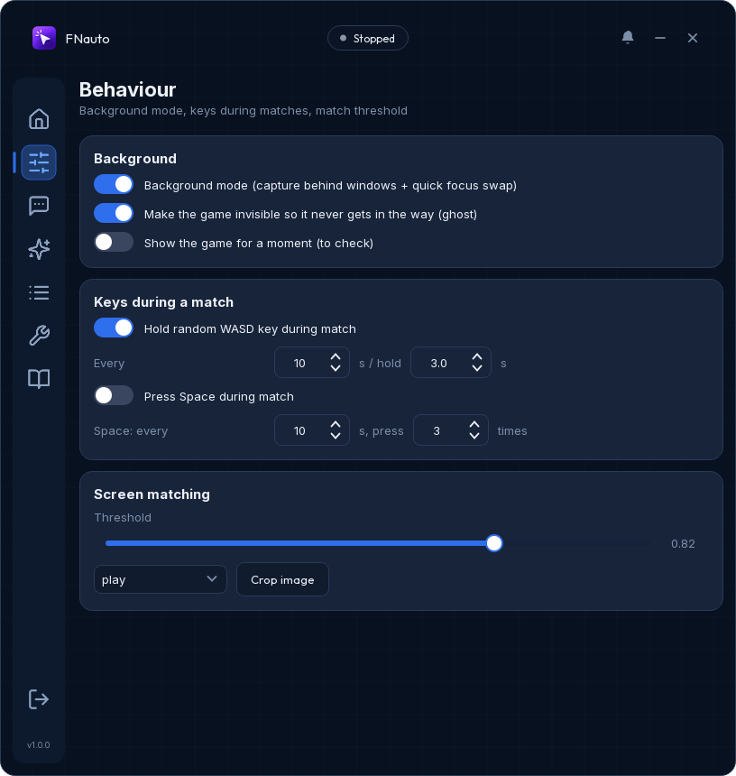
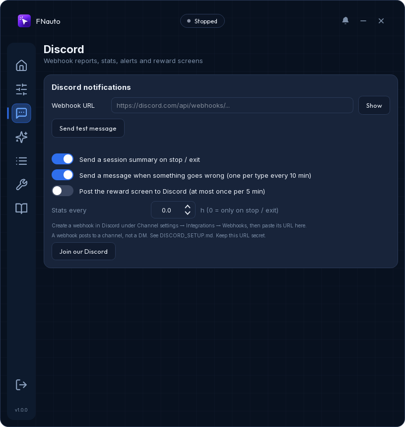

# FNauto

**Version:** 1.1

FNauto is a Windows desktop companion that automates repetitive Fortnite lobby and match loops. It can keep a match active, move through the post-match screens, return to the lobby, and repeat. Every action is local; there is no account, relay, bot, or telemetry service.







The screenshots were rendered offscreen from the default English UI with an isolated settings file. They contain no account names or personal data.

## Features

- **Loop modes** — A follows the normal Continue → Skip → Lobby path. B waits on the island and leaves with Esc. C waits on the island and switches to A when it detects an item.
- **Screen matching** — bundled button templates plus adjustable threshold, language selection, and a Crop image tool for your own capture.
- **Background mode** — capture the game behind other windows and optionally hide it while the loop runs.
- **AFK movement** — configurable WASD holds and Space presses during a match.
- **Humanized input** — jitter, delays, click cooldown, pickaxe breaks, coffee breaks, and randomized wait windows.
- **Recovery** — optional automatic relaunch after a crash or freeze, plus a Rescue listener and diagnostics.
- **Mini HUD** — a small on-top status window with Start/Stop and Expand controls.
- **Phone remote** — an optional LAN page for monitoring and control from a phone. It is off by default.
- **Discord notifications** — optional posts through a webhook that you create. No bot or private server is involved.
- **Six languages** — English, Japanese, Spanish, Portuguese, Russian, and French.
- **Local settings and logs** — no analytics and no background upload.

## Requirements

- Windows 10 or Windows 11, 64-bit.
- The release executable does not need Python installed.
- To run from source: Python 3.12 or newer, a 64-bit Python installation, and the packages in `requirements.txt`.

## Install and run

1. Download and extract the release archive.
2. Run `FNauto.exe`.
3. Open **Tools** to choose a theme, diagnostics, the phone remote, or the administrator restart.
4. Open **Behaviour** to configure the loop, background mode, keys, and screen matching.
5. Press **Start** on **Home**. Press **F8** or **Stop** to stop.

From source:

```bat
python -m pip install -r requirements.txt
python qt_app.py
```

Settings are stored at `%APPDATA%\FNauto\fnauto_settings.json`. On first launch, an older settings file beside the executable is imported once if the new file does not exist. The app never reads or writes settings from the source folder.

## Build the executable

Install the build tools and run the batch file:

```bat
python -m pip install -r requirements-dev.txt
build.bat
```

The PyInstaller one-directory build is written to:

```text
dist\FNauto\FNauto.exe
```

`build.bat` validates `icon.ico`, passes its absolute path to the build helper, and produces a windowed executable. It does not require network access.

To create a distributable ZIP and SHA-256 file after a successful build:

```bat
scripts\package_release.bat
```

This creates `FNauto-v<version>-win64.zip` and its `.sha256` file in the repository root. Neither file, nor `dist\`, is committed.

## Configuration

The main pages are:

- **Home** — state, laps, match counter, Start/Stop, relaunch, always-on-top, loop mode, wait times, stop-after limit, and language.
- **Behaviour** — background capture, ghost mode, AFK and Space keys, screen-matching threshold, template selection, and crop.
- **Discord** — webhook, test message, session summaries, problem alerts, periodic stats, and reward screenshots.
- **Extras** — audio and input, in-game automation, network and rescue controls.
- **Log** — current session messages, Copy, Clear, and Open folder.
- **Tools** — diagnostics, resolution/DPI check, Mini HUD, phone remote, theme, opacity, updates, and administrator restart.
- **Guide** — setup and troubleshooting notes in the selected language.

Useful shortcuts: **F8** stops the loop; **Ctrl+Tab** and **Ctrl+Shift+Tab** move between pages; **Ctrl+1** through **Ctrl+7** jump directly to a page.

## Discord notifications

FNauto posts only through a webhook that you create on your own Discord server. A webhook posts into a channel, not a DM. The URL is stored locally, masked in the app, and redacted from logs.

See [DISCORD_SETUP.md](DISCORD_SETUP.md) for the complete setup and troubleshooting guide. An empty webhook sends nothing.

## Phone remote

The phone remote is **off by default**. It starts only when you press **Tools → Phone remote** or enable its opt-in autostart. It binds to the local network, creates a new random token on each start, and rejects non-private clients.

Anyone who has the URL and token can control the PC while the remote is running. Stop the remote when you are finished.

The default setup is LAN-only. If you explicitly start the optional Cloudflare Quick Tunnel from the remote window, the URL becomes reachable outside the LAN and is protected only by the per-session token. Do not enable the tunnel on a network you do not trust.

The release does not bundle `cloudflared`. To install it yourself, download the official Windows AMD64 binary from <https://github.com/cloudflare/cloudflared/releases>, rename it to `cloudflared.exe`, and place it in `%LOCALAPPDATA%\FNauto\bin\` or add it to `PATH`. The app can also offer to download it after you confirm; the download is verified before use.

## Network connections

FNauto has no automatic telemetry, analytics, or startup upload. The connections are:

| Destination | When | Data |
|---|---|---|
| Your Discord webhook URL (`discord.com` or `discordapp.com`) | Only when you configure a webhook and enable a notification | Session summary, alert, progress report, or reward JPEG |
| `api.github.com` | Only if a build has an update repository configured and an update check is requested | Standard release metadata; no settings or screenshots |
| LAN address or `*.trycloudflare.com` | Only after you start the phone remote or its tunnel | Phone-remote page, status, frames, and control actions |

The GitHub update check is disabled in this build because `UPDATE_REPO` is empty. See [docs/NETWORK.md](docs/NETWORK.md) for the full network behavior and local-file list.

## Privacy

FNauto does not include telemetry, analytics, advertising, a relay, a bot, or a vendor account. It does not upload settings, logs, screenshots, or machine information. Discord posts happen only through the webhook you configure and the toggles you enable. The phone remote and tunnel are user-started. Logs and settings stay on your PC.

## FAQ

### Windows or antivirus reports the executable as unknown

The release is an unsigned PyInstaller executable. PyInstaller packages a Python runtime and application files into one directory, which can trigger reputation warnings. Verify the SHA-256 file from the release, build from source if you prefer, and do not disable security software just to run an unknown file. A false-positive report can be submitted to your security vendor.

### Does FNauto need Python installed?

No. The release archive contains the executable and its runtime files. Python is needed only to run from source or to build the executable.

### Where are my settings and logs?

Settings are at `%APPDATA%\FNauto\fnauto_settings.json`. Logs are written beside the settings file (`FNauto.log`). If Mode A stays in a match for 60 seconds without a state change, it logs the candidate scores and saves a frame in `%APPDATA%\FNauto\diagnostics` (up to five frames). Runtime data such as the loot vault and optional `cloudflared.exe` stays under `%LOCALAPPDATA%\FNauto`.

### Why does the update check do nothing?

This build has no update repository configured. A release owner can fill in `UPDATE_REPO` in `version.py`; the check remains off unless the user enables it. FNauto never downloads or replaces an executable automatically.

### Why is the phone remote not reachable from another device?

It is off by default and only listens on the LAN. Start it from **Tools**, use a private LAN address, and check Windows Firewall. A tunnel is optional, requires `cloudflared`, and carries the same access token in its URL.

## Disclaimer

Automation may violate the game's terms of service or rules. Use FNauto at your own risk. This project is not affiliated with, endorsed by, or sponsored by Epic Games, Inc. Fortnite and its game UI images belong to their respective owners; the bundled template images are used only for local screen matching and are not claimed under the project's MIT license.

## Contributing

Bug reports and focused pull requests are welcome. See [CONTRIBUTING.md](CONTRIBUTING.md). Please keep tests headless, use temporary settings, and never include webhook URLs, tokens, or personal screenshots.

Translations are welcome. The six language files are in the repository root; keep keys synchronized and run the tests before opening a pull request.

## Support

Join the community support server: <https://discord.gg/9cYDAtzuTF>

## License

MIT. See [LICENSE](LICENSE). Third-party components and font licenses are listed in [THIRD_PARTY.md](THIRD_PARTY.md).
